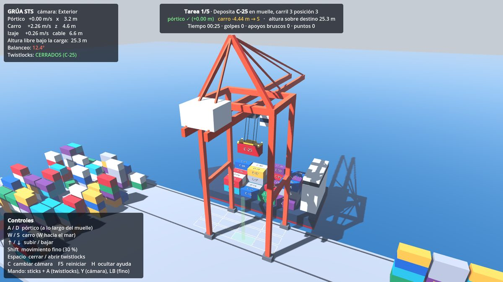
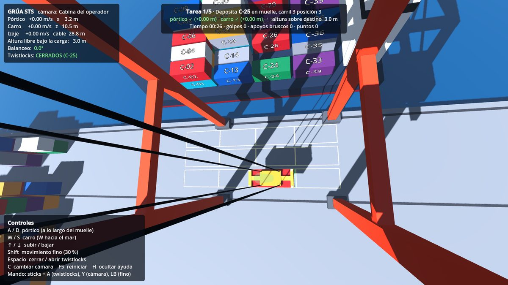
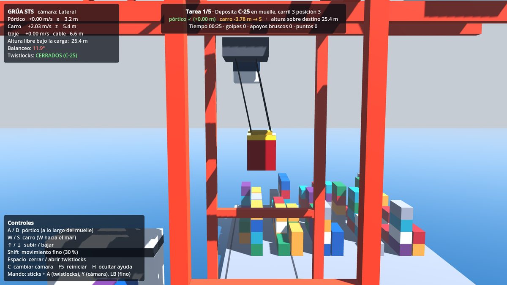
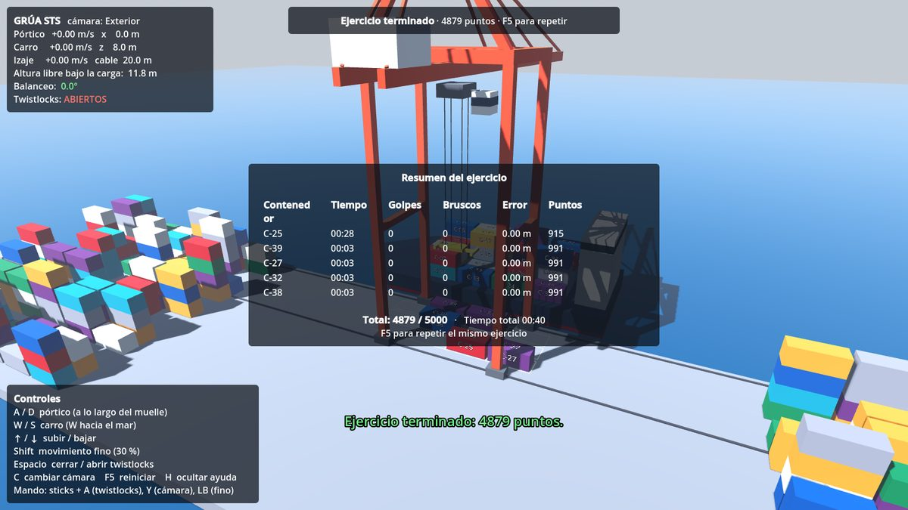

# Mini STS — Simulador de grúa portuaria

Prototipo de simulador de **grúa pórtico de muelle** (STS, *ship-to-shore*) hecho en **Godot 4** con GDScript.
El operador descarga contenedores de un barco al muelle controlando los tres movimientos de la grúa,
mientras la carga se balancea como un péndulo real.



| Cabina del operador | Vista lateral | Resumen del ejercicio |
|---|---|---|
|  |  |  |

## Qué incluye

- **Física de la carga**: péndulo esférico integrado con Verlet a paso fijo de 240 Hz; el balanceo aparece
  al acelerar o frenar el carro y el pórtico.
- **Accionamientos realistas**: cada eje tiene velocidad y aceleración máximas, y frena solo antes del final
  de carrera.
- **Contactos**: la carga se apoya en el muelle, la cubierta y otros contenedores; detecta golpes laterales y
  apoyos bruscos.
- **Seguridad**: freno por cable flojo y twistlocks que sólo cierran con el spreader apoyado y alineado.
- **Ejercicio de entrenamiento**: 5 tareas de descarga con puntuación (tiempo, golpes, apoyos bruscos y
  precisión). La misma semilla genera siempre el mismo ejercicio para comparar operadores.
- **Tres cámaras**: cabina del operador, exterior orbital y lateral.
- **Palancas físicas por red**: además de teclado y mando, recibe la posición de palancas por UDP
  (pensado para un ESP32 o Arduino con palancas industriales).
- **Pruebas automáticas** del modelo físico (incluye comprobar que el periodo del péndulo coincide con
  2π·√(L/g)).

## Cómo ejecutarlo

1. Instala [Godot 4.4](https://godotengine.org/download) o posterior (versión estándar, no hace falta .NET).
2. Abre Godot, pulsa **Importar** y elige el archivo `project.godot` de esta carpeta.
3. Pulsa **F5** para jugar.

### Controles

| Acción | Teclado | Mando |
|---|---|---|
| Pórtico (a lo largo del muelle) | A / D | Stick izquierdo ← → |
| Carro (W = hacia el mar) | W / S | Stick izquierdo ↑ ↓ |
| Subir / bajar | ↑ / ↓ | Stick derecho ↑ ↓ |
| Movimiento fino (30 %) | Shift | LB |
| Cerrar / abrir twistlocks | Espacio | A |
| Cambiar cámara | C | Y |
| Reiniciar ejercicio | F5 | Start |
| Mostrar / ocultar ayuda | H | Back |

En la vista exterior: clic derecho + arrastrar para girar, rueda para acercar.

### Palancas físicas (UDP)

El simulador escucha en el puerto **4242** mensajes JSON como este:

```json
{"gantry": 0.0, "trolley": 0.5, "hoist": -0.2, "lock": false}
```

Para probar sin hardware:

```bash
python3 tools/simular_palancas.py --carro 0.5 --segundos 3
python3 tools/simular_palancas.py --demo
```

### Pruebas automáticas

```bash
godot --headless --import            # sólo la primera vez
godot --headless -s tests/run_tests.gd
```

## Estructura

```
scripts/sim/     Física y reglas (sin gráficos): ejes, péndulo, patio, grúa, ejercicio
scripts/world/   Dibujo 3D: escenario, grúa, contenedores, cámaras
scripts/ui/      HUD
scripts/input/   Teclado/mando y palancas por UDP
scripts/main.gd  Une todo
tests/           Pruebas automáticas
tools/           Simulador de palancas en Python
docs/            Guía de desarrollo y capturas
```

La explicación completa de cómo se construyó y por qué se tomó cada decisión está en
[docs/GUIA_DESARROLLO.md](docs/GUIA_DESARROLLO.md).
